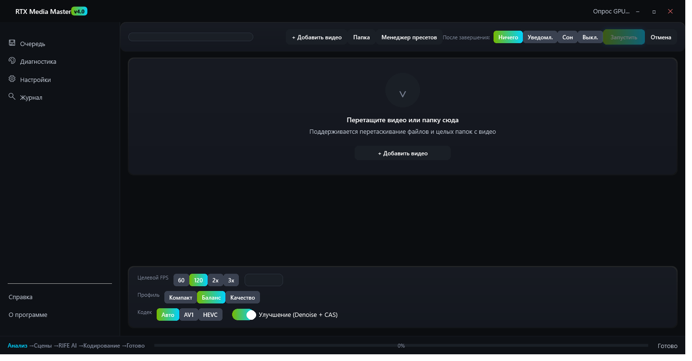
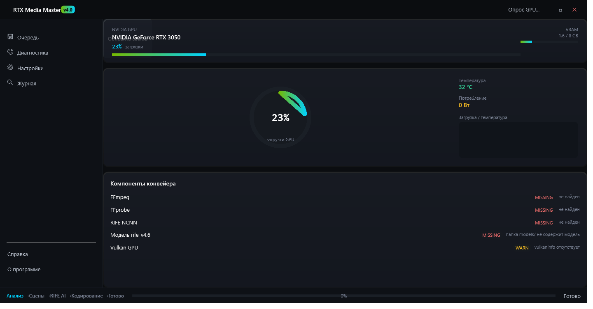
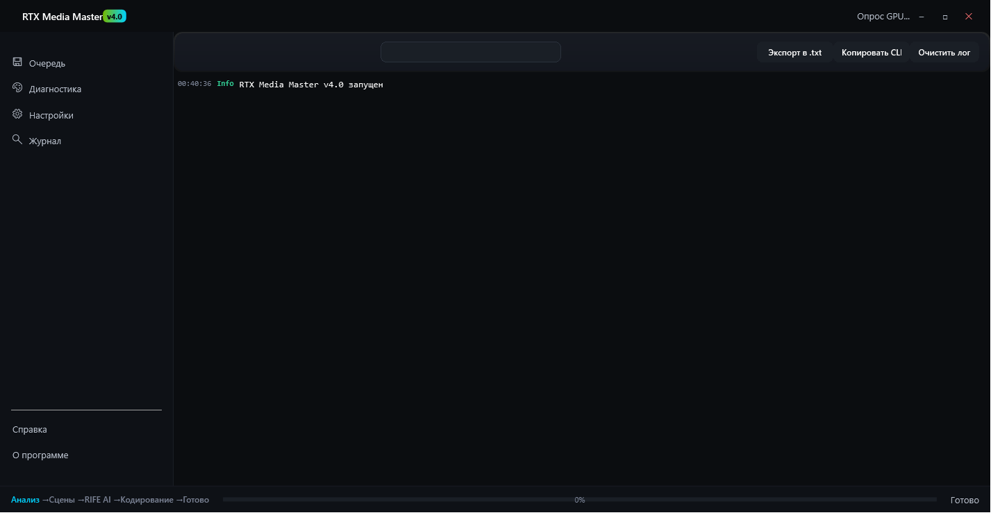

# RTX Media Master v4


**Автономная Windows-утилита для интерполяции видео до 60/120 FPS** на базе **RIFE (ncnn-vulkan)** и **FFmpeg**. Начиная с v4 графический интерфейс написан на **C# / .NET 8 (WPF)**: нативная разработка, стеклянные карточки, капсула GPU, степпер стадий и живая диагностика. Старый Tkinter-интерфейс удалён.

Программа превращает 24/30/60 FPS-ролики в плавные 60/120 FPS, сохраняя длительность и аудио. Есть пакетная очередь с Drag & Drop и поиском, менеджер пресетов, фоновый опрос GPU и ускоренное кодирование NVENC/AMF с программным фолбэком. Конечному пользователю Python не нужен: CLI-движок поставляется как `rtx_engine.exe`.

## Скриншоты (актуальная версия v4)

### Очередь: Drag & Drop, поиск и параметры обработки



### Диагностика: загрузка GPU, VRAM и компоненты конвейера



### Настройки: тема, видео, аудио и расширенные пути


### Журнал: вывод движка и проверка ffprobe



## Возможности

- **RIFE AI-интерполяция** через `rife-ncnn-vulkan` (модель rife-v4.6), автоматический выбор потоков `-j` под 4K.
- **Кодирование**: AV1 / HEVC / VVC / H.264, hardware-first (NVENC/QSV/AMF) с программным фолбэком, 10-bit, CQ/CRF и битрейт-лимиты.
- **`--enhance`**: bwdif + zscale + hqdn3d + CAS для деинтерлейса, апскейла и резкости.
- **Очередь**: поиск, асинхронные миниатюры, метаданные `ffprobe`, бейдж VFR, прогресс стадий и «Тест 5 сек» со сравнением «До / После».
- **Пили-переключатели** FPS (60/120/2x/3x), пресета (`compact/balanced/quality`), кодека и `Enhance`; менеджер пресетов и действие после завершения.
- **Диагностика**: загрузка GPU и VRAM через `nvidia-smi`, спарклайны, таблица компонентов и кодеров.
- **Журнал**: подсветка INFO/WARNING/ERROR, поиск, экспорт `.txt`, копирование CLI-команды и карточка итоговой проверки `ffprobe`.
- **Интерфейс**: тёмная тема, Mica/акрил, градиент RTX Green → Cyan, собственный заголовок и степпер `Анализ → Сцены → RIFE AI → Кодирование → Готово`.

## Headless-бэкенд

GUI запускает отдельный CLI-движок `rtx_engine.exe` (сборка из `src/rtx_engine.spec`), а если его нет — `python -u rtx_media_master_v35.py`. Интерфейс не блокируется на время рендера и по «Отмене» завершает дерево процессов. Для автоматизации движок можно вызвать напрямую:

```powershell
rtx_engine.exe --input input.mp4 --output output.mp4 --fps 120 --codec auto --preset balanced --enhance --no-progress
```

Полный список флагов — в `src/rtx_media_master_v35.py` и через `--help` CLI-версии.

## Установка

1. Скачайте `RTX_Media_Master_v3.msi` из [последнего релиза](https://github.com/xzktotobro1-ui/media-compilator-master/releases/latest).
2. Запустите установщик. Приложение установится в `C:\Program Files (x86)\RTX Media Master` и появится в меню «Пуск».
3. Для RIFE необходим GPU с поддержкой Vulkan. NVENC/AMF необязательны — есть программный фолбэк.

MSI показывает настоящий MIT License (Copyright (c) 2026 x_kitaikuyo_x), выбор папки установки сохранён. Портативный вариант: распакуйте `dist_new/RTX_Media_Master_v3` и запустите `RTX_Media_Master_v3.exe`.

## Быстрый старт

1. Перетащите видеофайлы или папку в зону очереди (или нажмите «Добавить видео»).
2. Пилюлями выберите целевой FPS, пресет, кодек и `Enhance`.
3. При желании нажмите «Тест 5 сек» и сравните «До / После» перед полным рендером.
4. Нажмите «Запустить». Результат появится рядом с исходником как `<имя>_120fps_master.mp4`, а в «Журнале» — CLI-команда и проверка `ffprobe`.

## Сборка из исходников

Python и .NET SDK нужны **только для сборки**. Подробности — в [docs/BUILD.md](docs/BUILD.md).

```powershell
dotnet build src/Gui/RTX_Media_Master_v3.csproj -c Release -o dist_new/RTX_Media_Master_v3
python -m py_compile src/rtx_media_master_v35.py
pyinstaller src/rtx_engine.spec --noconfirm --clean --distpath dist_new
# скопируйте ffmpeg/ffprobe/rife-ncnn-vulkan/models в dist_new/RTX_Media_Master_v3
python installer/generate_wxs.py
wix build installer/Package.wxs -o RTX_Media_Master_v3.msi
```

Автоматизация: `powershell -ExecutionPolicy Bypass -File build.ps1` (флаги `-SkipPyInstaller` и `-SkipDotNet` переиспользуют готовые сборки).

## Ограничения

- RIFE-режим требует Vulkan-совместимого GPU и полного пакета моделей (`flownet.param` + `.bin`).
- AV1-кодирование программными энкодерами заметно медленнее NVENC/AMF.
- Первое кодирование 4K может занять длительное время на слабых GPU.

## Сообщество

- [Сообщить об ошибке](.github/ISSUE_TEMPLATE/bug_report.md)
- [Предложить функцию](.github/ISSUE_TEMPLATE/feature_request.md)
- [Правила участия](CONTRIBUTING.md), [История изменений](CHANGELOG.md), [Планы](docs/ROADMAP.md), [Кодекс поведения](CODE_OF_CONDUCT.md)

Автор: **x_kitaikuyo_x**. Код приложения — [MIT](LICENSE). Сторонние компоненты перечислены в [NOTICE.md](NOTICE.md); бинарные зависимости в репозитории не хранятся.
