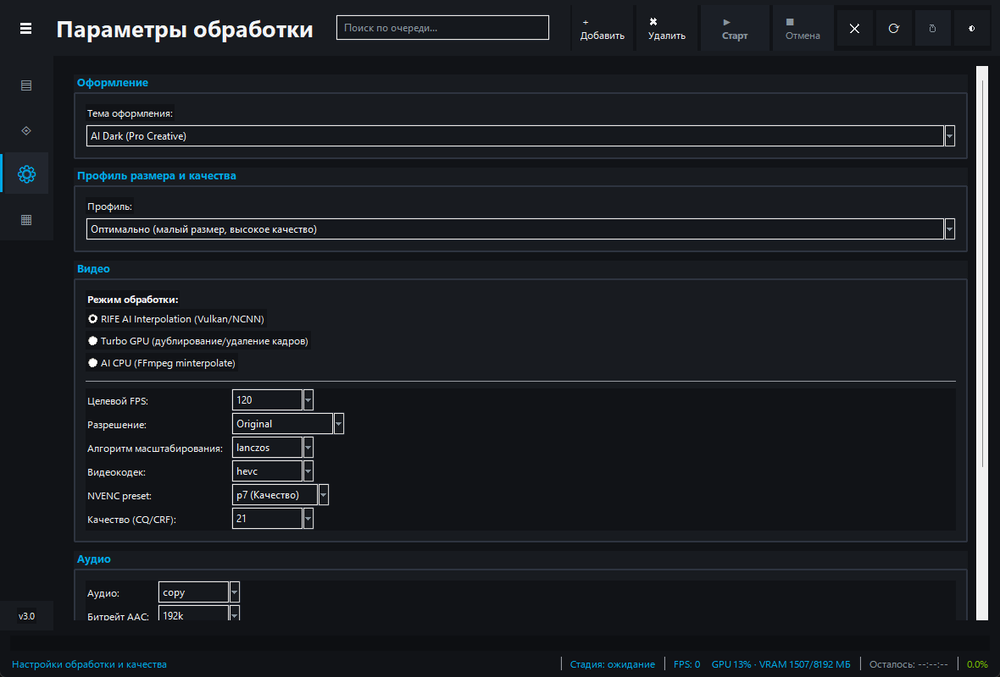

# RTX Media Master


**Автономная Windows-утилита для интерполяции видео до 60/120 FPS** на базе **RIFE (ncnn-vulkan)** и **FFmpeg**. Работает без установки Python: готовая сборка вместе со всеми зависимостями поставляется через MSI-установщик.

Программа предназначена для владельцев видеокарт NVIDIA/AMD с поддержкой Vulkan: она превращает 24/30/60 FPS-ролики в плавные 60/120 FPS, сохраняя исходную длительность и аудио. Есть пакетная очередь, инспектор файлов, диагностика GPU/VRAM и ускоренное кодирование NVENC/AMF с программным фолбэком.

## Скриншоты

### Очередь и инспектор файла


### Диагностика системы


### Параметры обработки



### Журнал выполнения


## Возможности

- **RIFE AI-интерполяция** через `rife-ncnn-vulkan` (модель rife-v4.6), автоматический выбор потоков `-j` под 4K и обычное разрешение.
- **Turbo GPU** — дублирование/удаление кадров через FFmpeg `fps`.
- **AI CPU** — `minterpolate` (mci/aobmc) для систем без Vulkan.
- **Кодирование**: H.264/HEVC через NVENC или AMF, AV1 через `libsvtav1` / `libaom-av1`; при недоступности железного энкодера — фолбэк на `libx264`/`libx265`.
- **Профили «качество ↔ размер»**, лимит битрейта, HDR-тонмаппинг, CAS-резкость.
- **Очередь файлов** с поиском, прогрессом стадий, ETA, бейджами длительности/FPS и карточкой-инспектором.
- **Диагностика**: реальные комплектующие, загрузка GPU и VRAM через `nvidia-smi`, проверка TensorRT.
- **Интерфейс** в стиле Windows 11 / Fluent: тёмная палитра AI Dark, светлая тема и тема «Как в Windows».
- **Никакого Python** на целевом компьютере — PyInstaller-сборка включает interpreter, Tkinter и все модули.

## v3.5 — GUI-программа с новым движком

Основной продукт v3.5 — полноценное оконное приложение `RTX_Media_Master_v3.exe`
и MSI-установщик. В интерфейс встроен тот же production-grade пайплайн, что и в
CLI-бэкенде: диагностика FFmpeg/FFprobe/RIFE/Vulkan, поиск модели `rife-v4.6`,
нормализация VFR→CFR, перекрывающиеся чанки с scene-cut `scdet`, двусторонний FPS,
современные кодеки с 10-bit и `--enhance`.

### Настройки движка в GUI

- **Кодек**: `auto`, `av1`, `hevc`, `vvc`, `h264`; автовыбор hardware-first (NVENC/QSV/AMF → программные), Early runtime-тест на 256×144 исключает нефункциональные энкодеры.
- **Пресет**: `compact`, `balanced`, `quality`; опциональные `--crf`/`--cq` доступны в бэкенде.
- **GPU**: индекс Vulkan-устройства; **Enhance**: bwdif + zscale + hqdn3d + CAS.
- **Целевой FPS**: как явное значение, так и множитель вида `2x`; повышение через RIFE, понижение через `fps`.
- В строке состояния отображается прогресс и итоговая статистика «до/после» по размеру файла.

### Headless-бэкенд

CLI сохранён только как внутренняя опция для автоматизации:

```powershell
RTX_Media_Master_v3.exe --headless --input input.mp4 --output output.mp4 --fps 120 --codec auto --preset balanced --enhance
```

Полный список флагов движка доступен в `src/media_engine_v35.py` и через `--help` CLI-версии.

## Установка

1. Скачайте `RTX_Media_Master_v3.msi` из [последнего релиза](https://github.com/xzktotobro1-ui/media-compilator-master/releases/latest).
2. Запустите установщик. Приложение установится в `C:\Program Files (x86)\RTX Media Master` и появится в меню «Пуск».
3. Для RIFE необходим GPU с поддержкой Vulkan. NVENC/AMF необязательны — есть программный фолбэк.

Портативный вариант: распакуйте содержимое `dist_new/RTX_Media_Master_v3` и запустите `RTX_Media_Master_v3.exe`.

## Быстрый старт

1. Перетащите видеофайлы в окно очереди или нажмите «Добавить».
2. Выберите режим (`RIFE AI Interpolation`, `Turbo GPU`, `AI CPU`) и целевой FPS.
3. Выберите профиль качества/размера и кодек.
4. Нажмите «Обработать». Результат появится рядом с исходником как `<имя>_120fps_master.mp4`.

## Сборка из исходников

Python нужен **только для сборки**. Подробности — в [docs/BUILD.md](docs/BUILD.md).

```powershell
python -m py_compile src/rife_120fps_v3.py
pyinstaller src/rife_120fps_v3.spec --noconfirm --clean --distpath dist_new
# скопируйте ffmpeg/ffprobe/rife-ncnn-vulkan/models в dist_new/RTX_Media_Master_v3
python installer/generate_wxs.py
wix build installer/Package.wxs -o RTX_Media_Master_v3.msi
```

Автоматизация: `powershell -ExecutionPolicy Bypass -File build.ps1` (флаг `-SkipPyInstaller` переиспользует готовую сборку).

## Ограничения

- RIFE-режим требует Vulkan-совместимого GPU и полного пакета моделей (`flownet.param` + `.bin`).
- AV1-кодирование программными энкодерами заметно медленнее NVENC/AMF.
- Первое кодирование 4K может занять длительное время на слабых GPU.

## Сообщество

- [Сообщить об ошибке](.github/ISSUE_TEMPLATE/bug_report.md)
- [Предложить функцию](.github/ISSUE_TEMPLATE/feature_request.md)
- [Правила участия](CONTRIBUTING.md), [ChangeLog](CHANGELOG.md), [Кодекс поведения](CODE_OF_CONDUCT.md)

## Лицензии

Код приложения — [MIT](LICENSE). Сторонние компоненты и их лицензии (FFmpeg, libx264, libx265, libsvtav1, RIFE, ncnn, Python, Tcl/Tk, PyInstaller, TensorRT, WiX) перечислены в [NOTICE.md](NOTICE.md). Бинарные зависимости не хранятся в репозитории.
